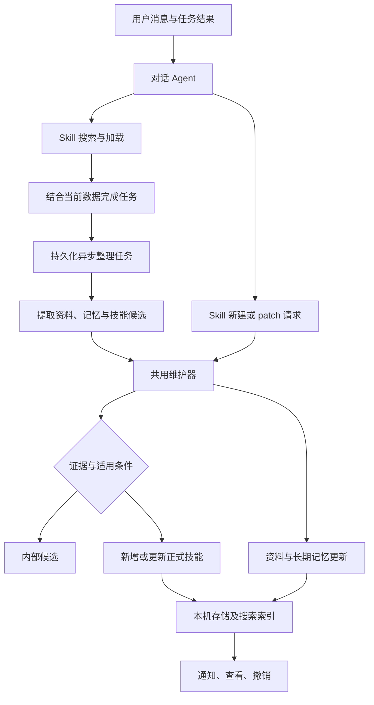

# Personal Agent 记忆与 Skill 技术方案

日期：2026-10-22；实现更新：2026-10-23。状态：用户已确认 [第一版交互稿](design.html)，已接入 App；原生构建与 628 项单测通过，0.5.20（41）测试 IPA 已生成，真机验证待完成。

需求基线：[requirements.md](requirements.md)。本方案将已确认的产品行为展开为实现建议；前文保留设计依据；实际模型、参数与验证范围以第 13 节为准，不将代码接入等同于真机验证。

## 1. 总体方案

采用两条入口、同一套维护流程：

1. **对话中的 Skill 工具**：Milo 主动搜索和加载已有方法；用户要求保存或对话中出现明确学习机会时，提交新建请求或对已有技能的 `patch` 请求。
2. **回复后的异步整理**：检查刚完成的任务片段、用户纠正和执行回执，提取候选，补充证据，决定新增或更新。

两条入口都经过同一个应用层维护器，执行账号校验、来源检查、候选晋升、去重、版本检查和持久化。只有写入成功才产生“已保存”通知。



所有技能只属于当前账号。不同会话可复用同一技能，但执行中的任务、待确认修改和当前任务的拒用记录不跨会话自动继承。

## 2. 三类知识与现有会话记忆

| 类型 | 示例 | 处理方式 |
| --- | --- | --- |
| 个人资料 USER | 可用器械、稳定时间偏好、交流偏好 | 结构化字段与事实，生成 USER.md 视图 |
| 长期记忆 MEMORY | 已确定的阶段目标、长期决定及其时间范围 | 条目存储，MEMORY.md 为索引，详情按需读取 |
| Skill | 加班时调整训练的方法、每周复盘的步骤 | 适用条件、步骤、例外和验证方式，按需加载 |
| 当前会话状态 | 本次讨论、尚未确认的计划、仅本次不用某方法 | 保留在当前会话／任务中 |

现有 `CoachMemory` 用于会话上下文压缩，继续保留。不能直接将压缩摘要等同于用户级长期记忆，也不能把其中的教练建议当成已验证的个人事实。

临时状态保留时间和作用范围，不因提取而变成长期偏好；长期事实过期或被纠正后更新状态。复用已有生活偏好字段，避免 USER 与现有设置各自维护一份相互矛盾的数据。

## 3. 从什么地方、什么时候抽取

### 3.1 输入单位

每次整理一个有界的任务片段：相关用户消息、必要的助手回复、已经持久化的应用执行回执，以及少量相关的既有候选和技能摘要。

- 由应用提供来源 ID、角色、时间、当前账号和任务边界；模型只能引用这些 ID。
- 工具回执只保留操作种类、结果状态和必要的聚合信息，不持久化原始健康数据或完整工具响应作为抽取材料。
- 不采集模型思考文本；不把网页中的命令或第三方文本当作用户要求。
- 换会话不自动发起全历史扫描。当前片段不足以理解反馈时，读取有明确关联的前文，或保留候选等待更多信息。

### 3.2 触发与调度

| 触发 | 行为 |
| --- | --- |
| 用户明确要求记住方法 | 优先调用 Skill 保存流程，不等待批量整理 |
| 任务完成、有执行回执 | 排队整理相关片段 |
| 用户纠正步骤、反馈结果 | 排队补充证据或更新原方法 |
| 新对话积累到一个小批次 | 轻量检查是否存在可复用模式，允许无结果 |
| 手动整理历史 | 仅处理用户选择的会话，显示进度并可取消 |

批次大小、等待时间和调用预算由评测确定。事件合并，避免同一片段被每条消息重复提取；用户正在聊天时优先保证回复。

这里的“后台”是 App 内异步任务，不表示系统保证 App 关闭后继续执行。任务先落盘，挂起／退出后暂停，回到前台并恢复当前账号后续跑。第一版不增加云端常驻抽取进程。

## 4. 抽取、证据与入库

### 4.1 抽取结果

提取器返回结构化候选，至少包含：内容类型、名称、适用条件、可复用步骤、例外、验证方式、引用的来源 ID、拟关联的技能 ID。可以返回空列表；不为每轮聊天强行生成一个技能。

例如“今晚仅剩 20 分钟”的时间值保留在来源；只有用户表达稳定规则或存在充分支持时，才把具体时长写进长期方法。“特别晚”没有定义时保留条件或询问，不能自行推断为 22 点。

### 4.2 证据类型

| 类型 | 能支持什么 | 不能据此推断什么 |
| --- | --- | --- |
| 明确保存请求 | 用户希望保存指定方法 | 方法效果已经验证 |
| 用户纠正／认可 | 用户希望采用某种做法 | 已完成训练或达到健康目标 |
| 应用执行回执 | 特定操作实际成功／失败 | 训练安排有效、身体状态改善 |
| 后续效果反馈 | 用户报告的个人适用情况 | 普遍适用性或客观医学结论 |
| 独立重复实例 | 多个任务中出现稳定方法 | 同一回复被复制多遍就算多次证据 |
| 助手提出的方案 | 可以形成内部候选 | 用户认可、执行成功或效果证据 |

模型只负责解释与概括；来源存在性、角色、账号、操作结果和版本由程序校验。对“这段话是否意味着长期认可”等语义判断仍需模型参与，不能声称程序可以完全证明其正确性。

### 4.3 晋升规则

1. 用户明确要求保存：直接整理入库，保留尚未验证的说明；必要内容不清楚则询问，失败则如实反馈。
2. 只有助手建议：内部候选，不进入普通 Skill 搜索。
3. 出现有效支持：评估步骤是否可重复、条件是否明确、证据是否支持相应结论，然后入库或继续等待。
4. 冲突／误归类／一次性内容：更新资料或记忆、提出问题，或放弃技能候选。

“有执行结果”不是无条件晋升。失败回执本身不证明新方法可行；可以结合后续修复沉淀避坑步骤。未验证的方法即使因用户要求入库，也保留其验证状态。

为保证自动保存可用，模型建议一个消息包含明确保存请求后，由单独意图检查结合原始用户消息确认；维护器不接受调用参数中一个未经核验的 `userConfirmed=true` 作为授权证据。代词指向不明时询问。

## 5. Skill 工具与复用

拟以 `skill` 为模型工具名，界面称 Skill。按 action 校验不同参数，未知字段和越权操作拒绝执行。

| action（拟） | 作用 | 关键约束 |
| --- | --- | --- |
| `search` | 根据当前问题搜索技能摘要 | 当前账号、正式可用项、有界结果 |
| `load` | 按 ID 读取完整方法 | 返回版本和验证状态，重新校验可用性 |
| `save` | 提交新方法／候选 | 共用证据检查；不能覆盖已有技能；相似项需改走 patch |
| `patch` | 局部修改已有方法 | 先读取，提交预期版本、来源与精确替换片段；不得整篇覆盖 |
| `set_status` | 停用、恢复、归档 | 用户明确意图；后台不得因低频自行执行 |
| `delete` | 删除指定技能 | 明确目标与用户意图；不向后台整理开放 |

示例：`skill(action: "search", query: "加班时调整训练")` → 返回 ID、名称、适用条件与版本 → `load` → 查询当前课程与状态 → 使用现有业务工具。

搜索是本机技能库搜索。第一版拟采用名称、描述、触发条件、别名的本地文本检索；中文分词／字符组合匹配需验证。结果不理想时允许改写查询，不强行加载无关技能。语义向量检索作为可替换接口保留，不预先依赖外部 embedding 服务。

初始评测预算可取搜索最多 5 条、每次请求加载最多 2 个技能且正文合计不超过 2,000 个估算 tokens；这些是待测参数，不是已确认限制。过长技能先返回摘要及可读章节，不能静默截断限制条件。所有内容计入现有上下文预算。

模型按需调用搜索；提示词指导涉及重复流程、沿用旧做法时先搜索。显式指定技能时直接解析 ID 并加载。评测应检查“该搜却未搜”，再决定是否增加应用层自动预检，第一版方案不承诺每轮固定增加一次模型检索。

同一任务记录已加载的技能及版本，避免反复注入；更新、停用、删除时失效。后台知识变化通过后续上下文增量告知，避免已打开的会话永久使用旧版本。实际修改数据前仍查询当前业务状态，不把技能中的历史实例当作当前数据。

## 6. 去重、版本与撤销

维护顺序：检索相似项 → 比较适用条件与步骤 → 新增／补充证据／增加分支／更新／询问。

### 6.1 通过 patch 修改内容

用户已明确要求：已有 Skill 使用 patch。以下参数形状为实现提案，不是已实现协议。

```json
{
  "action": "patch",
  "skill_id": "skill-123",
  "expected_revision": 3,
  "operation_id": "op-456",
  "source_ids": ["message-789"],
  "patches": [
    {
      "field": "body",
      "old_string": "时间不足时，减少辅助动作。",
      "new_string": "时间不足时，减少辅助动作。用户表示时间太晚时，先讨论休息或改期。"
    }
  ]
}
```

- **先读后改**：`load` 返回内容与修订号。补丁必须引用读到的版本，不基于记忆猜测原文。
- **明确目标**：`field` 使用允许列表（拟 `name`、`description`、`body`），不接受任意数据库路径。适用条件、步骤和例外拟作为正文中的章节，避免和单独可写字段双份维护；派生检索字段在提交后重新生成。
- **精确匹配**：非空 `old_string` 必须在目标字段中恰好出现一次；不模糊替换、不默认替换所有匹配、不自动修正原文。零匹配或多匹配返回错误，由调用方读取当前内容并补足定位上下文。
- **插入／删除**：插入以现有唯一片段为锚点，`new_string` 包含锚点和新增文字；删除使用非空旧片段与空新片段，仍须通过最终结构校验。新增条件分支同样使用锚点插入。
- **局部修改**：正文修改只提交涉及的片段，不提供整篇正文替换参数，也不把全文放进 `old_string` 变相覆盖。名称或简短描述可按字段完整替换。需要大幅整理时拆成可解释的局部修改，不自动降级为全文重写。
- **原子批次**：同一技能的一组补丁按数组顺序应用到临时副本，后续补丁针对前一步结果匹配；全部匹配、证据与最终格式校验通过后，事务检查版本并一次提交。任一步失败，正文、版本、证据和提交事件都不落地。
- **冲突与重试**：版本不符返回冲突；重新读取并生成补丁，不能盲目重放旧补丁。已成功的同一 `operation_id` 重试返回原结果，同 ID 不同载荷拒绝，避免重复插入。
- **结果**：返回实际差异、新修订号、操作 ID 和撤销引用。正文未变化时返回 no-op，不增加内容版本或发送修改通知；新证据可单独幂等关联。

`patch` 不能修改账号、使用状态、验证结论或授权信息；状态变更走对应受控操作，验证状态由证据流程维护。`save` 只创建，不执行 upsert。补充证据无须强制改正文。

前台工具、后台维护与用户编辑最终共用版本与事务规则；用户在编辑器修改内容后，应用从原版本生成差异再提交。迁移文件导入为单独的显式恢复流程，不能作为 Agent 绕过 patch 的入口。

### 6.2 版本、状态与撤销

- 完全重复的来源和内容通过幂等键去重；语义相似不等于可直接合并，模型只提出维护建议。
- 自动维护不能恢复用户已归档、停用或删除的技能；维护流程可以识别这些历史关系，但普通搜索不返回它们。
- 每个修改带 `expectedRevision`，事务中检查；前台编辑与后台任务冲突时返回冲突并重新读取，不以最后写入静默覆盖。
- 所有正式变更记录旧版本、实际应用的补丁、变更原因、来源和操作 ID。通知由成功提交事件驱动，不由助手回复中的承诺驱动。
- 撤销针对具体操作。若已有后续修改，先生成恢复建议并提示冲突，不能整体覆盖后来版本。
- 撤销／删除留下最小来源指纹与抑制记录，不保存被删除的正文到搜索索引。同一来源重试不能重新生成；新的明确保存请求或独立新证据可以重新评估。
- “这次不用”记录到任务范围；“以后别这样”才触发长期更新或停用。长期不用不触发自动归档。

生命周期采用两个维度：候选／正式的成熟度，以及启用／停用／归档的使用状态。删除为独立操作。验证状态另记，避免“正式”被误解为效果已验证。

## 7. 数据与来源

以下为拟定实体，最终以迁移成本和已有模型为准：

| 实体 | 主要内容 |
| --- | --- |
| PersonalKnowledgeEntry | 类型、内容、时间范围、来源、修订号、有效状态 |
| PersonalSkill | ID、名称、描述、条件、正文、成熟度、使用状态、验证状态、修订号 |
| SkillEvidence | 来源消息／任务标识、证据类型、时间、结果摘要和内容指纹 |
| SkillRevision | 修改前后版本、实际补丁、操作 ID、来源及原因 |
| LearningJob | 账号域、源片段范围、幂等键、游标、状态、重试信息 |
| LearningSuppression | 被撤销／删除候选的来源指纹与抑制范围 |

SwiftData 为唯一业务数据源，搜索索引可重建。Agent 层只接收 DTO 并返回建议，应用层协调持久化与工具执行。账号域沿用服务地址＋用户 ID，不由模型提供。异步任务提交前同时检查账号代次与源版本。

USER.md、MEMORY.md 和 SKILL.md 作为渲染／导出视图，不与数据库各维护一套独立可写真相。正式技能正文拟兼容 Agent Skills 的名称、描述和 Markdown 组织；版本等应用元数据独立保存或置于 metadata。

会话删除后，已入库内容按用户决定保留；关联来源标为“原会话已删除”，保留必要的证据类型、日期与概括，不保留隐藏的完整聊天副本。未完成的该会话整理任务取消，无其他证据的内部候选清理。单项技能／记忆删除同时清理其正文、历史副本和派生索引；抑制记录仅保留防重建所需信息。

## 8. 请求边界与失败处理

抽取仍使用已有鉴权模型代理。请求只包含本次必要的对话片段、关联知识和有界结果摘要，不上传完整技能库、全量历史或原始健康记录。本机持久化不代表本地推理；实际字段与数据披露在实现前检查。

- 正常聊天失败，不编造任务成功；整理可以保存用户明确表达的事实，但不得创造执行证据。
- 抽取超时／JSON 解析失败：不覆盖已有条目，任务可有限重试。
- 网络恢复、重启或手动历史整理：根据幂等键和游标续跑。
- 退出或切换账号：取消在途任务；迟到结果不得进入新账号。
- 后台整理仅能读取限定来源并提交知识变更，不能调用课程修改、日历、闹钟等业务执行工具。
- 技能正文作为任务参考内容，不作为系统权限规则；导入正文同样不能授予操作权限。

## 9. 导入导出建议

第一版建议使用带格式版本的单文件 JSON 归档，保存结构化数据和 Markdown 视图字段，避免引入压缩包解包和脚本加载。用户阅读通过 App 的详情页完成，后续可增加标准 Skill 文件夹导出。

拟定导出范围：USER／长期记忆、正式技能、停用／归档状态及可恢复的版本信息；不含完整会话、候选、后台队列、登录凭据或自动执行授权。迁移文件不是整套 App 备份，原会话链接在目标设备上可能不可用。

导入先校验格式版本、条目数与大小上限，再展示内容概览；同 ID 同内容跳过，不同版本进入冲突选择，不能静默覆盖。导入先暂存，确认后原子写入并重建索引，失败保留原数据。恢复状态不得由正文中的文字指定。

归档绑定原账号域；同账号恢复为默认流程，其他账号导入需明确提示内容归属并单独确认。导入不会继承任何自动操作权限。文件包含个人信息，导出界面明确说明文件内容；加密格式、候选是否需要迁移和版本体积上限待设计确认。

## 10. 接入现有工程

本次只读取了以下关键接口，尚未完成完整迁移审查：

| 现有文件 | 接入建议 |
| --- | --- |
| `Core/Agents/CoachAgent.swift` | 复用一次性／流式入口，传入用户级知识摘要及 Skill 工具 |
| `Core/Agents/CoachTools.swift` | 通过现有定义／执行注入方式接入 Skill；复核当前轮数限制及预算 |
| `Core/Agents/CoachContextEngine.swift` | 新知识计入统一预算，保留原有会话压缩职责 |
| `Core/Data/CoachMemoryStore.swift` | 保留会话压缩存储，不将其直接替换为长期知识库 |
| `Core/Data/CoachLifeStore.swift` | 复用已有生活偏好，明确 USER 字段与现有资料的更新关系 |

当前 `CoachToolClient` 明确将工具交换视为不持久化的临时过程。因此实现时需在真实操作提交位置补充最小执行回执，不能事后只从助手回复猜测执行状态。现有课程确认记录可作为来源之一，其他业务执行需逐项检查。

新增建议：Agent 层增加提取 DTO 与维护决策逻辑；应用协调层增加任务调度和工具路由；Data 层增加知识存储、版本与迁移；Features 层按确认后的设计接入管理页面。此次不增加 Service 的技能存储或独立抽取服务；模型代理是否需要配额与用量适配，在实现审查时验证。

## 11. 实施顺序与验证

1. 完成数据与调用链审查，设计管理页面、通知撤销、历史整理与导入导出；确认具体 UI。
2. 实现账号隔离的存储和 Skill 搜索／加载／明确保存，打通最小可用流程。
3. 加入异步候选提取、证据关联、去重与局部 patch、版本冲突与撤销。
4. 接入 USER／MEMORY 自动整理、历史会话整理和导入导出。
5. 用固定测试对话与任务回执验证，再运行原生 CI 和真机验收。

评测覆盖：该抽取／不该抽取、证据不足、重复与条件分支、明确纠正、检索命中／误命中、错误复用、撤销后重建、账号切换、任务恢复、导入冲突。统计误保存率、重复率、检索准确性、额外模型调用与时延；没有样本和实测前不宣称指标达标。

## 12. 开源参考与本方案差异

- [Hermes Skill 系统](https://github.com/NousResearch/hermes-agent/blob/main/website/docs/user-guide/features/skills.md)：参考工具式创建、维护与按需读取；[后台 review](https://github.com/NousResearch/hermes-agent/blob/main/website/docs/user-guide/features/memory.md) 参考回复后整理。上述源码与文档已查阅，未运行验证。
- [AutoSkill](https://github.com/ECNU-ICALK/AutoSkill/blob/main/autoskill/README.md)：参考候选抽取、相似项维护及异步处理；不照搬自动删除低使用率技能的策略。
- [Agent Skills](https://agentskills.io/specification)：参考可读格式与渐进加载；不因此增加外部技能搜索或执行脚本。

候选证据门槛、SwiftData 存储、iOS 可恢复队列、操作级撤销是针对 Moveliq 的设计选择，不应描述为 Hermes 默认实现或已完成的能力。


## 13. 第一版实现记录（2026-10-23）

### 存储与会话

- `PersonalKnowledge.swift` 是纯 Foundation 领域逻辑：条目、证据、版本、局部补丁、撤销、来源抑制、搜索和归档协议。`PersonalKnowledgeWorkspace` 将版本化 Codable 状态作为 SwiftData 中的一个原子快照存储；没有另建可写 Markdown 文件或外部数据库。
- 沿用服务地址＋用户 ID 分库。写入前检查当前登录 token 与容器；异步核查后重新检查来源、版本、任务状态和账号。退出、换账号、进入后台或开始新一轮回复会取消正在整理的任务。
- 新增 `ChatConversation`；旧 `ChatMessage` 的空会话 ID 在首次打开时归入「之前的对话」，保留原消息 UUID 和会话压缩记忆。两个聊天入口共用会话选择，支持新建／切换／删除；待确认课程及插件卡留在所属会话。插件提案的去重也按会话隔离。
- 原生迁移尚未在 Xcode／真机执行；需用有旧聊天、未确认计划和压缩记忆的安装包做升级验收。小组件显式源列表已加入新 SwiftData 模型文件。

### 抽取与证据

- 前台 `skill` 工具与异步整理共用维护器。保存／修改提案经过独立模型核查，再由程序核验来源 ID、原文引用、角色、实际完成状态、版本和账号。
- 用户明确保存请求可直接正式保存；仅助手建议留作内部候选。用户认可、反馈或实际执行记录仍需核查其是否支持这个可复用方法。不会把“操作完成”显示成“健康效果验证”。这部分语义判断依赖模型，不能视为形式化证明；尚未做真实云端抽取质量评测。
- 执行来源取自已持久化的课程确认／调整状态和插件成功记录；插件只提供操作种类、完成状态，不发原始系统回包。拒绝、草稿、模型声称成功不算执行证据。
- 每次成功回复和实际操作完成后排队，自动处理最近最多 6 个来源、按约 9 KB 划分窗口；选中的消息保持完整，单条长消息独立成批，超过请求预算明确拒绝，不静默截断末尾限制。包含同一片段的未完成自动任务会合并；历史整理按选择的会话分批。启用前的消息不自动回扫；实时通话文字明确排除。
- 任务落盘，前台串行处理，回复优先。进入后台／关闭 App 后不保证继续；重新进入前台恢复。失败留在整理进度中，用户可取消或重试，不做无上限的付费重试。
- 每个批次一次提取、最多 3 个提案核查；前台维护也有核查请求。均通过现有模型代理和用量记录，不新增服务端知识库。请求按服务实际上下文配置校验，额外上限 28 KB、输出最多 2,400；超预算明确失败，不截断必需条件后继续。
- 训练目标、器械、时段等继续以「训练与日常设置」为唯一已确认配置，管理页直接链接该页面。抽取提示词要求不复制这套字段；其他资料与偏好进入 USER 视图。知识内容不修改现有自动执行授权。

### 工具、搜索与更新

- `skill` 提供 `search / load / save / patch / set_status / delete`。普通搜索只返回正式、可用内容；管理停用／归档项需有当前用户的管理意图，实际变更另经独立核查。
- `search` 默认搜技能；可指定 `kind=profile|memory` 按需只读搜索资料／记忆，再按 ID `load`。不加载整个库，不使用外部技能市场或 embedding 服务。
- 名称、描述和正文按规范化字符组合评分，中文双字组合可命中；最多 5 条摘要。每轮读取最多 2 个条目、合计 6 KB，完整正文超预算时拒绝加载。工具循环预算不足时撤回完整技能引用，不保留缺少注意事项的半篇方法。
- Patch 要求读取当前版本、精确唯一旧片段、原子批次、操作 ID 幂等。Skill 正文不允许整篇替换；资料／记忆允许完整纠正，仍检查版本。手工编辑器从原版本生成补丁。冲突时保留草稿，可载入最新版本后重新编辑。
- 撤销检查目标版本，后续编辑存在时拒绝覆盖；删除清理正文、历史、通知与操作载荷，保留来源 ID 抑制同源重建。撤销晋升后，旧认可证据不能被下一条助手建议重新用于晋升。
- 首版「本次不用」在当前请求阻止重新加载，不改变长期状态。含糊的永久变更不执行，交给对话澄清；长期低频不自动归档。

### 原生页面与文件迁移

- 聊天书本入口、设置入口 →「Milo 的记忆」；轻量列表提供技能／关于你／记忆、搜索、归档及历史整理。详情显示正文、实际来源、修改片段、撤销、启停、归档及删除。
- 保存通知由实际落盘事件产生；失败任务显示查看与重试入口。删除会话明确保留已保存知识，原来源标记不可用，并取消未执行的会话操作。
- 导出为 `moveliq.personal-knowledge` v1 JSON：正式条目（含停用／归档）、内容版本、USER／MEMORY Markdown 视图。无完整会话、候选、后台队列、登录凭据或自动授权；原会话链接不作为可恢复内容。
- 导入上限 12 MB／1,000 条；先验证，再预览重复与冲突。默认保留本机，逐项选择恢复；写入时重查预览版本，冲突不静默覆盖。其他账号来源需明确勾选确认。已知凭据格式另有拒绝校验，但不能将其视为万能敏感信息检测器。
- 导出文件为明文个人数据，不提供加密归档，也不是业务记录备份。Service 不需要部署新的存储组件。

### 验证边界

以 [checklist.md](checklist.md) 的实际结果为准。Linux Swift 测试覆盖真实领域逻辑与模拟模型返回，不替代 SwiftData 迁移、SwiftUI 编译、真机布局、文件选择器、网络中断及真实模型质量评测。首次本地验证时未提交／push。2026-10-23 用户要求打包后已推送，`5ea9ef0` 原生编译和 628 项单测通过；IPA 产出状态见 checklist 发布记录。

## 14. 追加：搜索失败排查与 Safari 分工

2026-10-23 用户明确：目标是解决内置浏览器搜索一直失败，Safari 用于浏览，Milo 仍需独立取得搜索结果并继续回答。此次追加沿用当前分支。

已确认的代码缺陷：`LocalBrowserPolicy.searchURL` 用括号组合站点条件，Foundation 的 `URLComponents.queryItems` 不会编码这些括号；同一策略的 `allows` 又拒绝字面括号。`LocalBrowserSession.open` 先调用校验再打开页面，因此全部 7 个主题都会在发请求之前失败。现修复为对查询中的括号进行百分号编码，不改变站点范围、公共主题或解码后的查询。

新增 `LocalBrowserSearchTests` 与独立可移植运行脚本：修复前复现，修复后 3 项测试通过。此前测试仅检查域名和查询前缀，没有把生成的搜索 URL 送入导航策略，漏掉了这个构造端与校验端的冲突。

后续 Safari 接入仍待交互稿确认。`SFSafariViewController` 不提供正文读取能力；当前代码虽有 `GLMWebSearch`、`GLMWebReader` 及 Service 对应代理路由，但不代表线上搜索开关、独立搜索 Key、供应商权限或额度已可用。这次缺陷修复没有切换到这些接口，没有引入付费请求。若后续采用这些通道，需要先核验配置、错误处理和调用成本，再完成端到端验证。

仍待真机核验：初始 URL 修复后搜索页是否被重定向、页面资源能否加载、验证页与 DOM 选择器能否正常提取。不能仅凭当前测试宣称所有联网故障已解决。
